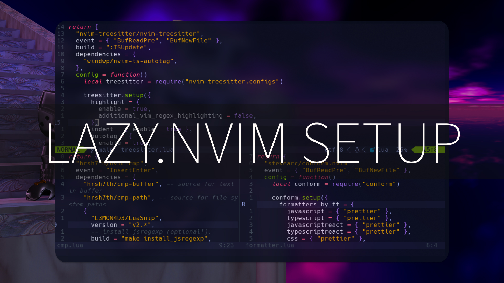

# Neovim config

My personal Neovim setup — [lazy.nvim](https://github.com/folke/lazy.nvim) plugin
manager, [kitty-themes](https://github.com/odysseyalive/kitty-themes.nvim) (SeaShells) theme, LSP via
Mason, and a LaTeX workflow built on VimTeX + Sioyek.

Originally based on [slydragonn/nvim-lazy](https://github.com/slydragonn/nvim-lazy)
(hence the `lua/slydragonn/` namespace), since diverged.



## Requirements

- Neovim >= 0.10
- A [Nerd Font](https://www.nerdfonts.com/font-downloads) in your terminal
- Git, a C compiler, and `make` (for treesitter parsers and `avante.nvim`)
- Node.js + npm (for the TS/web language servers and Copilot)
- Optional, for LaTeX: `latexmk`, `sioyek`, and `neovim-remote` (`pipx install neovim-remote`)

## Install on a new machine

```bash
git clone https://github.com/EricBoittier/nvimconfig.git ~/.config/nvim
nvim
```

This is a private repo, so the clone will ask for credentials — use a personal
access token with `repo` scope as the password, or swap in the SSH remote
(`git@github.com:EricBoittier/nvimconfig.git`) once that machine's key is added
to your GitHub account.

On first launch lazy.nvim bootstraps itself, installs every plugin at the exact
versions pinned in `lazy-lock.json`, and Mason pulls the language servers and
formatters. Let it finish, then restart.

To update plugins: `:Lazy sync`, then commit the refreshed `lazy-lock.json` so
your other machines land on the same versions.

## Layout

```
nvim/
├── init.lua                     entry point + LaTeX autocmd
└── lua/slydragonn/
    ├── settings.lua             vim options
    ├── maps.lua                 core keymaps (leader = space)
    ├── lazy.lua                 plugin-manager bootstrap
    └── plugins/                 one file per plugin, auto-imported
        └── lsp/                 lspconfig + mason
```

Everything in `plugins/` is picked up automatically by the `{ import = ... }`
calls in `lazy.lua` — to add a plugin, drop in a new file returning a lazy spec.

## Keymaps

Leader is <kbd>Space</kbd>.

### Editing & windows

| Key | Action |
| --- | --- |
| `<leader>w` | Save |
| `<leader>q` | Quit |
| `jk` (insert) | Escape to normal mode |
| `<leader>o` / `<leader>p` | Split vertical / horizontal |
| `<C-h/j/k/l>` | Move between windows |
| `<C-arrows>` | Resize window |
| `<leader>f` | Format file (or selection in visual mode) |
| `<F7>` | Floating terminal |

### Files & search

| Key | Action |
| --- | --- |
| `<leader>e` / `<leader>r` | Toggle / focus Neo-tree |
| `<leader>ff` | Find files |
| `<leader>fg` | Live grep |
| `<leader>fb` | Buffers |
| `<leader>fs` / `<leader>fc` | Git status / commits |

### LSP

| Key | Action |
| --- | --- |
| `gd` / `gD` | Definitions / declaration |
| `gR` / `gi` / `gt` | References / implementations / type definitions |
| `K` | Hover docs |
| `<leader>ca` | Code actions |
| `<leader>rn` | Rename symbol |
| `<leader>d` / `<leader>D` | Line / buffer diagnostics |
| `[d` / `]d` | Previous / next diagnostic |
| `<leader>rs` | Restart LSP |

### Git & sessions

| Key | Action |
| --- | --- |
| `<leader>gg` | Neogit UI |
| `<leader>ws` / `<leader>wr` | Save / restore session for cwd |

### Copilot

| Key | Action |
| --- | --- |
| `<C-j>` (insert) | Accept suggestion |
| `<C-k>` (insert) | Reject suggestion |

Tab is deliberately left alone (`copilot_no_tab_map`). Run `:Copilot setup` once
per machine to authenticate.

## Language support

Language servers installed by Mason: `cssls`, `eslint`, `html`, `jsonls`,
`ts_ls`, `pyright`, `tailwindcss`.

Formatters (run on save via `conform.nvim`): `prettier` for web/JSON/YAML/
Markdown, `stylua` for Lua, `isort` + `black` for Python.

Treesitter parsers include the above plus `bash`, `fortran`, `dockerfile`, `vim`.

## LaTeX

`vimtex.lua` compiles with `latexmk -lualatex` and previews in Sioyek with
forward/inverse search wired through `nvr`. `init.lua` also sets `textwidth=65`
with auto-wrapping in `tex` buffers.

## Notes

- `lazy-lock.json` **is** committed on purpose — it's what keeps machines in sync.
- `.luarc.json` files are gitignored: lua_ls regenerates them with absolute
  `$HOME` paths, so they can't be shared.
- `pack/` is gitignored. It used to carry a second, vendored copy of
  `copilot.vim` that lazy.nvim already manages; plugins belong in `plugins/`.
